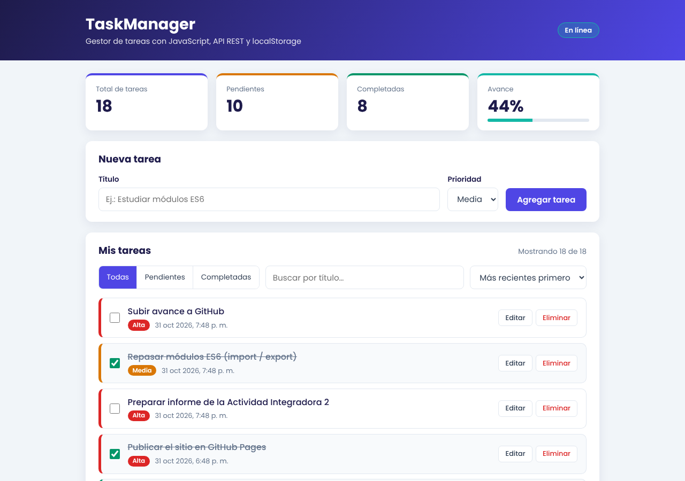

# TaskManager

**Estudiante:** Genesis Espinoza
**Asignatura:** Programación de Sistemas Web — Universidad ECOTEC
**Actividad:** Actividad Integradora 2

## Descripción

TaskManager es una aplicación web para gestionar tareas, escrita en **JavaScript Vanilla (ES6+)**, sin librerías ni frameworks. Permite crear, editar, eliminar y completar tareas; filtrarlas, buscarlas y ordenarlas; y ver métricas en tiempo real. La primera vez importa tareas de la API pública **JSONPlaceholder** y después guarda todos los cambios en **localStorage**, por lo que sigue funcionando sin internet.

## Funcionalidades

| Módulo | Qué hace | Técnica JS |
|---|---|---|
| Gestión CRUD | Crear, editar, eliminar y marcar como completada. Valida que el título no esté vacío. | `addEventListener`, arreglos y objetos |
| Filtros y búsqueda | Todas / Pendientes / Completadas y búsqueda en tiempo real por título | `filter`, `includes`, `toLowerCase` |
| Ordenamiento | Por fecha de creación o por prioridad (Alta, Media, Baja) | `sort()` con funciones comparadoras |
| Dashboard | Total, pendientes, completadas y porcentaje de avance | Actualización del DOM después de cada cambio |
| API REST | Carga inicial con `fetch()` y `async/await` cuando localStorage está vacío | `fetch`, `try/catch`, notificaciones visuales |
| Persistencia | Cada cambio se guarda y se recupera al recargar | `localStorage.setItem`, `JSON.stringify`, `JSON.parse` |

## Investigación técnica: Arquitectura modular ES6 (Opción A)

El código está dividido en módulos nativos con `import` / `export`:

```
taskmanager-js/
├── index.html          → carga js/main.js con <script type="module">
├── css/styles.css
├── js/
│   ├── main.js         → punto de entrada: coordina los módulos y los eventos
│   ├── ui.js           → interfaz visual (DOM)
│   ├── api.js          → servicio de la API REST (JSONPlaceholder)
│   ├── storage.js      → gestor de localStorage
│   └── tareas.js       → lógica: validar, crear, filtrar, ordenar, métricas
├── img/captura-app.png
├── AI_DECLARATION.md
└── README.md
```

## Cómo ejecutar el proyecto

Los módulos ES6 **no funcionan si se abre `index.html` con doble clic** (`file://`): el navegador exige un servidor.

**Opción 1 — En línea (GitHub Pages):** https://geespino.github.io/taskmanager-js/

**Opción 2 — Visual Studio Code:**

1. Clona o descarga el repositorio y abre la carpeta en Visual Studio Code.
2. Instala la extensión **Live Server**.
3. Clic derecho en `index.html` → **Open with Live Server**.

Para ver los datos guardados: **F12 → Application → Local Storage → `taskmanager_tareas`**.

## Captura de pantalla


